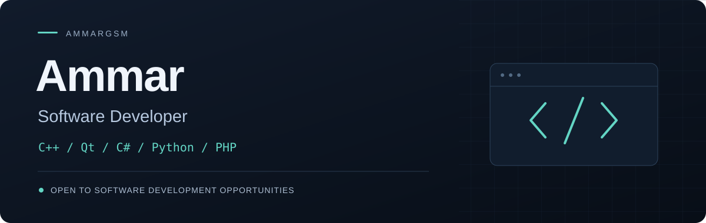

 

**C++ & Qt · C# · Python · PHP / Laravel**

Developing desktop applications, web software, and tools that connect software with devices.

 

&nbsp;

 

## About

I'm **Ammar**, also known as **AmmarGsm**. I develop software across desktop, web, mobile, and embedded environments, with a particular focus on **C++ and Qt desktop development**.

My background includes Android / GSM utilities and device-oriented workflows. I’m interested in roles where I can contribute to useful software, solve technical problems, and grow within an engineering team.

## Technical skills

<table>
<tr>
<td width="50%" valign="top">

### Desktop development

**C++ · Qt · C# · Delphi**

Desktop applications, graphical interfaces, and software utilities.

</td>
<td width="50%" valign="top">

### Web development

**PHP · Laravel**

Web applications and backend development.

</td>
</tr>
<tr>
<td width="50%" valign="top">

### Automation & scripting

**Python**

Scripts and utilities for practical, repeatable workflows.

</td>
<td width="50%" valign="top">

### Mobile & embedded

**Flutter · Arduino · ESP32**

Mobile interfaces and microcontroller development.

</td>
</tr>
</table>

 

 
Also working with <strong>Delphi</strong> and <strong>ESP32</strong>.

## Opportunities

I'm looking for **software development opportunities**, particularly in **C++ / Qt desktop applications**. My broader stack includes C#, Delphi, Python, PHP / Laravel, Flutter, Arduino, and ESP32.

For hiring enquiries and professional conversations, reach me on **[Telegram · @AmmarGsm](https://t.me/AmmarGsm)**.

---

<strong>AMMAR · SOFTWARE DEVELOPER</strong> Desktop / Web / Mobile / Embedded

